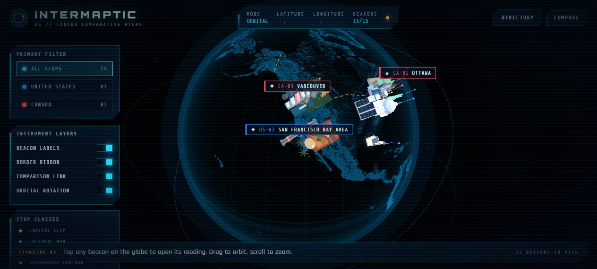

# Intermaptic

This is a 3D globe you can spin, zoom and tap. It compares the **United States** and **Canada**. For each place it looks at four things: geography, culture, government and economy. The globe has twenty-three landmarks. Each one has its own 3D model built from code.

It is built with Vite, React and react-three-fiber. The frontend is a static site that runs on **GitHub Pages**. The text it shows comes from a small read-only API hosted on **Render**. The frontend also keeps its own copy of the whole atlas. So the site still works if the API is missing, slow or down. It just uses the copy inside the app instead. The HUD tells you which one it used.



---

## What it does

- **A 3D globe you can spin, zoom and tap.** Each landmark is a hand-built 3D model. It stands on the surface of a dark, glowing planet. The models are meant to be the brightest thing you see.
- **Twenty-three beacons, twelve comparisons.** Each stop is matched with a stop across the border that fits the same theme. The themes are capitals, big finance cities, Pacific tech areas, inland economies and cultural hubs. Other themes are natural wonders, old quarters, carved rock, space and the northern sky. The last two are life at the top of the map. They also cover managed water next to wild water. The shared border is a pair too.
- **One paragraph for every stop.** It covers geography, culture, government and economy, and it is written for that exact place. The government part also explains how the local government works, not just the national one.
- **Side by side notes.** Each stop has a few comparison points. They name the stop it is matched with across the border. When you pick a stop, a curved line is drawn to its pair.
- **A country page.** One table for each country. It shows population, area, GDP, government, head of state, official languages and the health system. It also shows the numbers the two countries share.
- **The border, drawn on the globe.** The 49th parallel and the Great Lakes area are drawn as a glowing dashed ribbon. The eastern highlands and the Alaska and Yukon line are drawn too.
- **Live data or built in data, and it says which.** The API in `api/` can serve the atlas (see [Deploying](#deploying)). The status strip reads `DATA: LIVE API` when the API answered. It reads `DATA: SYNCING` while it is being asked. It reads `DATA: WAKING` while a sleeping backend is being woken. It reads `DATA: LOCAL` when the app uses its own copy. So you never have to guess where the words on screen came from.

### The twenty-three stops

| Pair | United States | Canada |
| --- | --- | --- |
| Capitals & Federal Power | Washington, D.C. (US Capitol) | Ottawa (Parliament Peace Tower) |
| Finance Megacities | New York City (Statue of Liberty) | Toronto (CN Tower) |
| Pacific Tech Corridors | San Francisco Bay Area (Golden Gate Bridge) | Vancouver (Canada Place) |
| Interior Economic Engines | Chicago (Willis Tower) | Calgary (Calgary Tower) |
| Cultural Hubs | Los Angeles (Capitol Records Tower) | Montreal (Notre-Dame Basilica) |
| Natural Wonders | Grand Canyon | Banff & the Canadian Rockies |
| Heritage & Old Quarters | New Orleans (St. Louis Cathedral) | Quebec City (Château Frontenac) |
| The Shared Border | Niagara Falls (both sides) | Niagara Falls (both sides) |
| Rocks From Deep Time | Mount Rushmore | Gros Morne |
| Rockets & the Northern Sky | Kennedy Space Center | Churchill |
| Life at the Top | Denali | Iqaluit |
| Managed Water, Wild Water | Hoover Dam | Bay of Fundy |

---

## Quick start

```bash
npm install
npm run dev          # http://localhost:5173
```

```bash
npm run build        # production bundle in dist/
npm run preview      # serve the built bundle

npm run check        # atlas data + model registry integrity
npm run check:reading # every reader-facing string is plain and short
npm run check:api    # every API route, called directly
npm run check:all    # all three
```

To run the backend on your own machine, open a second terminal:

```bash
npm start            # the API on http://localhost:3000 (the same server Render runs)
```

Then build or start the frontend against it:

```bash
VITE_API_BASE=http://localhost:3000 npm run dev
```

Needs Node 18 or newer.

---

## Deploying

The frontend and the backend deploy on their own, from this one repository.

| | Where | What it is |
| --- | --- | --- |
| Frontend | **GitHub Pages** | the static Vite build: the globe, the HUD and the readings |
| Backend | **Render** | the read-only JSON API in `api/`, served by `server/index.mjs` |

The same five handlers run on either backend host. So there is nothing to change between them:

| Host | How it runs the API |
| --- | --- |
| **Render** | `npm start` runs `server/index.mjs`, a Node web service that mounts the handlers |
| **Vercel** | each file in `api/` is served as a serverless function, and `vercel.json` is committed |

The frontend talks to the backend over HTTP. So it has to be told where the backend is at **build time** (`VITE_API_BASE`). The backend has to be told which origins may call it (`ALLOWED_ORIGINS`). Both are optional. See [Configuration](#configuration).

### 1. Backend on Render

`render.yaml` is a Render blueprint. So the fastest way is **New +** then **Blueprint**, and pick this repository. Render reads the blueprint and makes the service for you.

To make it by hand instead, use **New +** then **Web Service**. Pick this repository, then fill in:

| Field | Value |
| --- | --- |
| Runtime | Node |
| Build command | `npm ci` |
| Start command | `node server/index.mjs` |
| Health check path | `/api/health` |
| Instance type | Free (or Starter to avoid cold starts) |

Either way, Render sets `PORT` itself and the server reads it. Once it is live, the service URL looks like `https://intermaptic-api.onrender.com`. That URL is what the frontend needs as `API_BASE`.

The routes are:

| Route | Returns |
| --- | --- |
| `GET /api/atlas` | the whole atlas: every stop, every pair, the national comparison and the counts |
| `GET /api/stops` | the stop list, with `?nation=us\|ca\|shared` and `?kind=` filters |
| `GET /api/stops/:id` | one stop, its counterpart and its pair |
| `GET /api/search?q=` | ranked matches across every reader-facing string |
| `GET /api/health` | `200` when the data is valid, `503` when it is not |

All of it is `GET`-only public data. A `POST` gets a `405`. An origin outside `ALLOWED_ORIGINS` gets no CORS header when that variable is set. `GET /` lists the routes, so a bare visit explains itself.

**About the free instance type:** Render puts an idle free service to sleep. Waking it up takes about 30 to 60 seconds. That is longer than a page load will wait. A warm instance answers the first ask straight away. Nothing is pinged in that case and no loading screen appears. If nothing answers in five seconds the app treats the instance as asleep. It then shows a loading screen and pings the health route every few seconds. When the server answers, the atlas is loaded and the HUD switches to `DATA: LIVE API`. That screen is never a dead end. One button loads the built-in atlas right away. The app gives up after a minute and a half. It then reads the built-in copy and tries once more in the background. If you want live data from the first paint, use a paid instance type. Or point the frontend at Vercel instead.

### Backend on Vercel instead

Import the repository into Vercel and nothing needs to be set up. `vercel.json` is committed and every file in `api/` becomes a function.

```bash
npx vercel          # preview deployment
npx vercel --prod   # production deployment
```

### 2. Frontend on GitHub Pages

`.github/workflows/deploy.yml` builds and publishes the site on every push to `main`.

1. Push the repository to GitHub.
2. **Settings → Pages → Build and deployment → Source: GitHub Actions.**
3. Open **Settings → Secrets and variables → Actions → Variables** and add a new variable. Set `API_BASE` to your Render URL (for example `https://intermaptic-api.onrender.com`), with no slash on the end.
4. Push to `main` and the workflow takes it from there.

Skip step 3 and everything still deploys. The frontend just shows its own copy and the HUD reads `DATA: LOCAL`.

GitHub Pages serves the site from `/<repo-name>/`, so the workflow sets `VITE_BASE` to that sub-path. Vite writes the base into `import.meta.env.BASE_URL`. That is what the earth textures load through in `src/scene/Earth.jsx`. To build a sub-path bundle on your own machine:

```bash
VITE_BASE=/intermaptic/ npm run build
```

### Configuration

Copy `.env.example` to `.env` for local work. The two variables that matter here:

| Variable | Used by | Meaning |
| --- | --- | --- |
| `VITE_API_BASE` | the frontend, at build time | where the API is, for example `https://intermaptic-api.onrender.com`. `same-origin` calls `/api` on whichever host serves the page |
| `ALLOWED_ORIGINS` | the API, at runtime | a comma-separated list of origins that may call the API, for example `https://yourname.github.io`. If it is not set, any origin may call it. That is the default, because this is public read-only data |

### Optional: one origin for both halves

`server/index.mjs` serves the API only, and the frontend is the static build on GitHub Pages. If you later put the API behind the same domain as the site, set `VITE_API_BASE=same-origin`. Then the page calls `/api` on its own origin instead of a full URL. Use that setting if you ever host the two together on one host.

---

## Architecture

```
index.html                 app shell + font links + web app manifest
gallery.html               dev-only model gallery (not in the production build)
public/manifest.webmanifest  lets an iPad save the atlas to its home screen
render.yaml                Render blueprint for the API service
vercel.json                Vercel config, if you prefer that backend host
.env.example               documented environment variables
.github/workflows/         GitHub Pages deploy for the frontend
public/textures/           dark earth map and land mask used by the globe shader

server/                    the Node web service Render runs
  index.mjs                entry point: reads PORT, listens, closes on SIGTERM
  app.mjs                  the router, shared by Render and local development

api/                       the same handlers, also deployable as Vercel functions
  atlas.js                 GET /api/atlas
  stops/index.js           GET /api/stops
  stops/[id].js            GET /api/stops/:id
  search.js                GET /api/search?q=
  health.js                GET /api/health
  _lib/http.js             CORS, JSON responses, the read-only route wrapper
  _lib/atlas.js            shapes the data for the wire and measures reading level

scripts/
  check-atlas.mjs          data + model-registry integrity check
  check-reading-level.mjs  the 6th grade rule, enforced
  check-api.mjs            calls every API handler directly

src/
  main.jsx  App.jsx        entry + shell (intro, overlays, Escape handling)
  state/AtlasContext.jsx   all shared state: selection, hover, filters, layers, API load
  lib/theme.js             design tokens, nation colours, model tuning
  lib/geo.js               lat/lng -> Vector3, surface orientation, great circles
  lib/api.js               the API client, with the bundled fallback and the wake ping
  lib/device.js            performance tier for iPads and other touch devices
  data/
    locations.js           aggregator: STOPS, PAIRS, national comparison, validation
    us.js  ca.js           the eleven American and eleven Canadian stops
    us-extra.js ca-extra.js  the four landmarks added to each country later
    shared.js              the shared-border stop + the stop schema reference
    border.js              boundary waypoints and border facts
  models/
    index.js               model registry + the MODEL AUTHORING CONTRACT
    us/ ca/ shared/        twenty-three procedural landmark models
  scene/
    Scene.jsx              the R3F canvas and its lighting
    Earth.jsx              holographic globe shader, atmosphere, orbit rings
    Starfield.jsx          nebula shell and three star layers
    Landmarks.jsx          places and scales the models on the sphere
    Markers.jsx            beacon rings, pin stems and decluttered labels
    BorderRibbon.jsx       the boundary ribbon
    CompareLink.jsx        the arc drawn between a stop and its counterpart
    CameraRig.jsx          orbit controls + the scripted fly-to
  ui/                      Hud, InfoPanel, ComparePanel, AtlasPanel, Intro, LoadingScreen
  styles/global.css        the whole bridge-console design system
  dev/Gallery.jsx          the model gallery
```

### How a landmark gets onto the globe

Models are built in their own unit space. The base sits at local `y = 0` and `+Y` points up. The model is about `1.0` unit tall. `src/lib/geo.js` turns a stop's latitude and longitude into a spot on the sphere. `surfaceQuaternion` turns local `+Y` onto the surface normal. So a model that stands up on its own also stands up on the planet. Everything else is scale.

### Keeping a crowded hemisphere easy to read

All twenty-three landmarks sit inside one continent. Washington and New York are a few hundred kilometres apart. On a globe of this radius, that is barely the width of one model. Left alone, the field looks like a pile. Three things in `src/scene/` keep it clear:

- **Labels fade out.** Every name plate is turned into screen space once per frame. Then the plates are sorted and given room one at a time. Focused and hovered ones come first, then the ones nearest the camera. Anything that would bump into something else is dropped. In practice only eight to ten of the twenty-three names stay at full-globe range. Note that drei renders `<Html>` children into a separate React root. So R3F hooks are not available inside a label. The declutter loop therefore lives in the Canvas tree. It reaches each DOM label through a ref.
- **Models shrink when you are far away.** `Landmarks.jsx` eases each model as the camera comes in. It grows from `farScale` at full-globe range to full size, using the numbers in `MODEL_TUNING`. The wide view shows small, separate monuments. Flying to a stop brings it up to full detail.
- **The far side is not drawn.** The globe hides a model behind the horizon anyway. So it is skipped instead of drawn. That is also the cheapest frames you can give an iPad.

---

## Extending it

### Adding a stop

1. Add an entry to `src/data/us.js`, `ca.js`, `us-extra.js`, `ca-extra.js` or `shared.js`. The exact schema is written at the top of `src/data/shared.js`, with a worked example. A stop needs `id`, `name`, `country`, `kind`, `lat`, `lng`, `model`, `tagline` and `pair`. It also needs three `facts`, the four `sections`, and two or more `comparison` bullets.
2. Point `model` at a key in `src/models/index.js`, and add the matching React component.
3. Run `node scripts/check-atlas.mjs`. It fails loudly if a section is missing or a coordinate is bad. It also fails on a model id that is not registered. It fails too when a registered model has no stop.

### Reading level

**Everything a reader sees about the two countries is written for a 6th grade level.** That is about age 11 to 12. That means the taglines and the quick facts. It also means the four `sections` on every stop and the `comparison` bullets. The pair notes in `src/data/locations.js` and the country-level rows in `NATIONAL_COMPARISON` count too. The reading panel joins the four `sections` into one paragraph. So a stop reads as prose about the place. The rules are:

- no sentence longer than **15 words**.
- **two sentences per section**, because a stop is a glance, not an article.
- everyday words, with no jargon left unexplained.
- no semicolons and no em dashes in reader-facing text.

It is checked, not just meant:

```bash
npm run check:reading
```

That script walks every string in the data files and measures each sentence. It reports the average, the longest sentence, and any string that breaks a rule. Today it reports 386 strings and 549 sentences. The average sentence is 8.9 words, and the longest is exactly 15 words. It fails a section that runs to three sentences. `npm run check:all` runs it with the atlas and API checks. The GitHub Pages workflow runs all three. So a hard-to-read sentence cannot reach the deployed site.

### Adding a landmark model

Read the **MODEL AUTHORING CONTRACT** at the top of `src/models/index.js`. In short: one component that is the default export. It takes `{ tint, hovered }` and returns one `<group>`. Its base sits at `y = 0` and it is about `1.0` unit tall. It is built from three.js primitives only. No `.glb` files, no loaders, no textures, no lights.

Then look at it in the gallery:

```bash
npm run dev
# http://localhost:5173/gallery.html          all twenty-three models in a grid
# http://localhost:5173/gallery.html?elev=38  raised camera, to judge flat features
# http://localhost:5173/gallery.html?only=cn-tower   one model, large and centred
```

> When you tune a model, remember that the globe hides its far side. A landmark is most often seen from **directly above**. So roofs and top-down patterns matter as much as the outline. That is why the Grand Canyon's gorge and the Willis Tower's stepped roof plan are built the way they are.

---

## Accessibility and performance

- **Mouse, touch and keyboard.** Beacons respond to pointer and touch. `Escape` closes the overlay stack, then clears the current selection. Buttons are real `<button>` elements with focus-visible styling.
- **Reduced motion.** `prefers-reduced-motion: reduce` turns off all animation and transitions.
- **iPad and touch.** Controls get a 44px minimum touch target. Feedback that used to show on hover now shows on tap. So nothing stays lit up after a tap. Safe-area insets are respected in landscape. The page can also be saved to the home screen and opened full screen. Zoom is left on on purpose. `src/lib/device.js` picks a performance tier. It caps the render resolution, thins the starfield and lowers the segment count on tablets. You cannot see the difference on a screen that size. It is the difference between smooth and stuttering.
- **Mobile.** Below 900px the rail becomes a horizontal strip. The reading panel becomes a bottom sheet. The fly-to camera offsets its target. So the focused landmark lands clear of the sheet, not behind it.
- **The same geometry every time.** There is no `Math.random()` in a model or the starfield. So the scene looks the same on every load.
- **Hint for big screenshots:** editing `MODEL_TUNING.scale` in `src/lib/theme.js` resizes every landmark at once.

---

## Assets and credits

- `public/textures/earth-dark.jpg` and `earth-topology.png` come from the [three-globe](https://github.com/vasturiano/three-globe) project. They are public earth images taken from NASA. They are committed locally, so the globe never asks for images at runtime. The topology map works as a land mask. A gradient across it paints the glowing coastlines.
- Fonts (Orbitron, Rajdhani and Share Tech Mono) load from Google Fonts in `index.html`. Monospace and sans-serif fallbacks sit in `src/styles/global.css`.
- All twenty-three landmark models are original geometry written for this project.

## Known limitations

- The boundary ribbon and the stop coordinates are simplified. They are chosen to look right at globe scale, and they are not survey-grade.
- Landmark models are stylised, recognisable outlines, not surveyed copies.
- The national comparison figures are rounded 2024 estimates. They come from the IMF, the World Bank and national statistics offices. The UI labels them as approximate.
- The 6th grade rules are measured on sentence length and a word list. That is a good guess at how easy text is to read. It is not a replacement for a teacher's judgement.
- The API is read-only public data. There are no accounts and no writes. There is no rate limiting beyond the host's edge caching.
- The free Render instance sleeps when it is idle. So the first visit after a quiet spell shows the built-in atlas. About half a minute later, the live one takes over.
